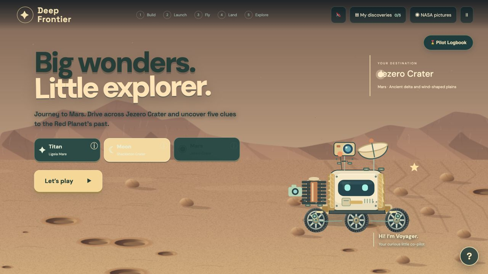
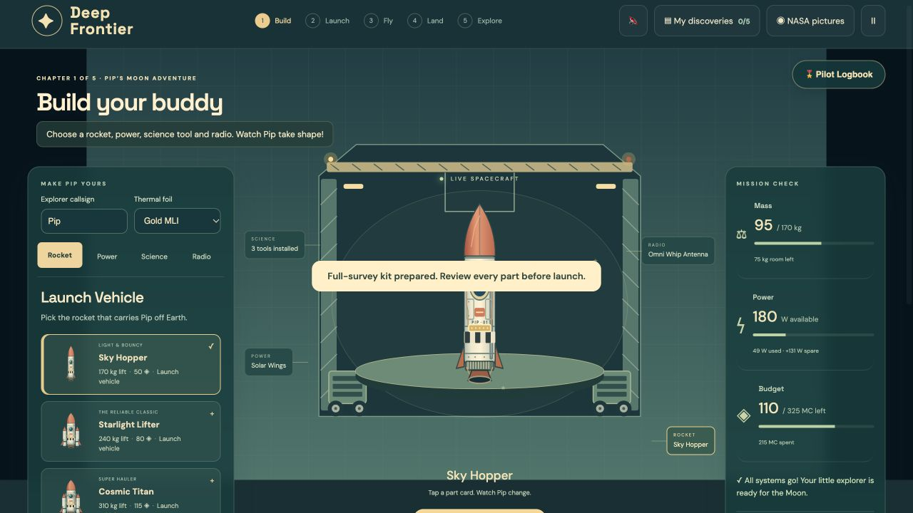
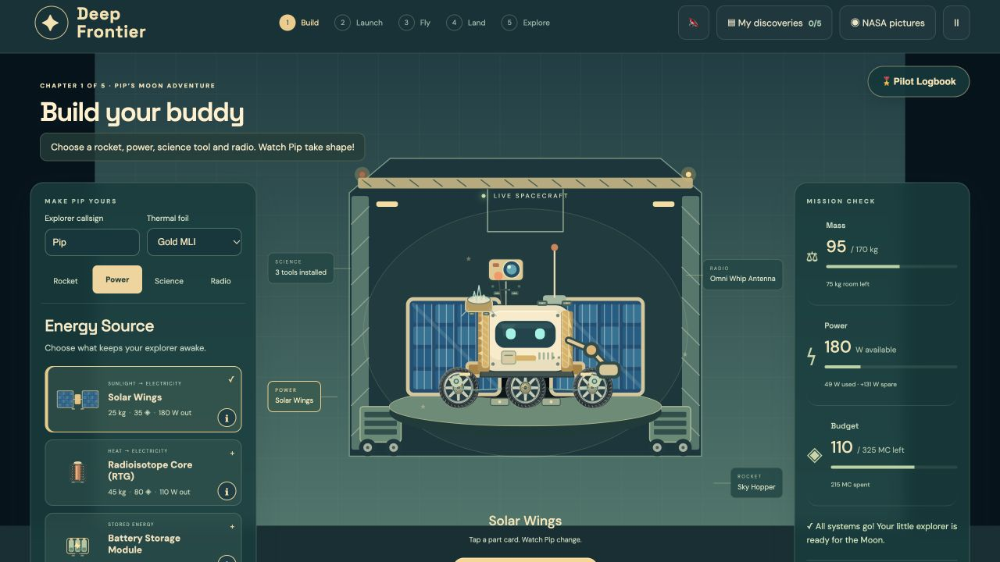
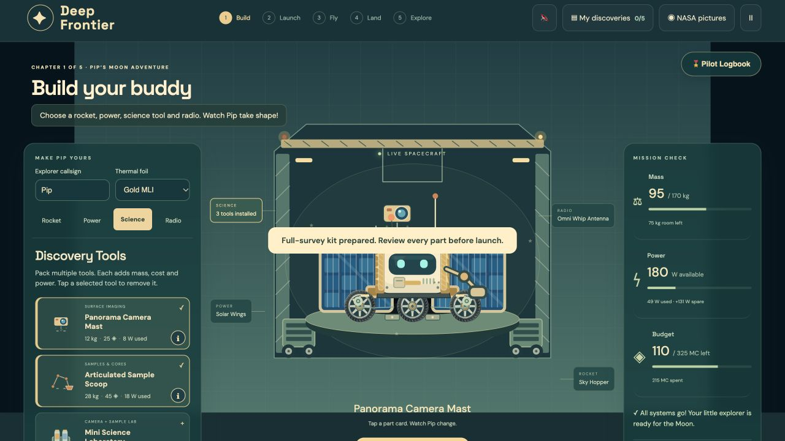
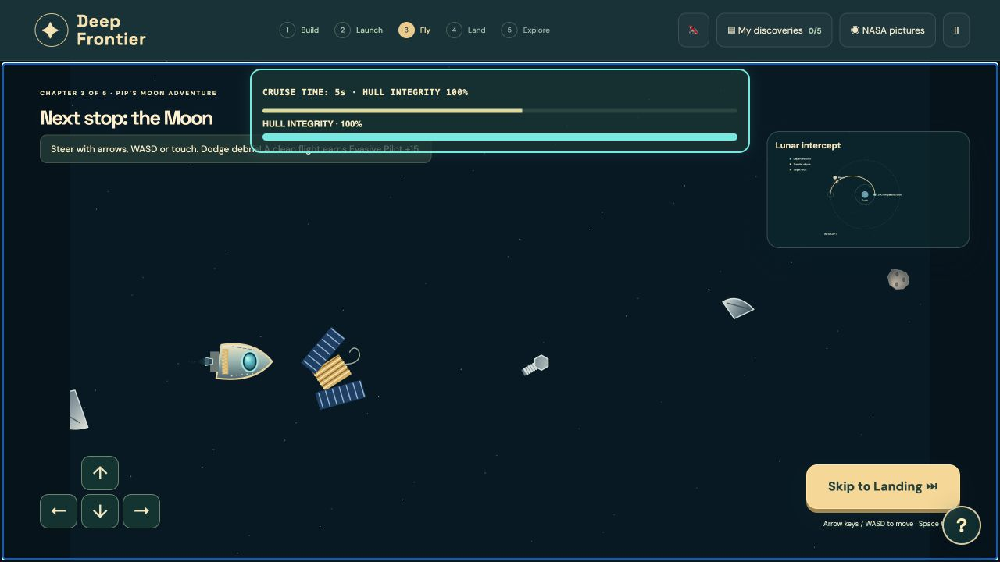
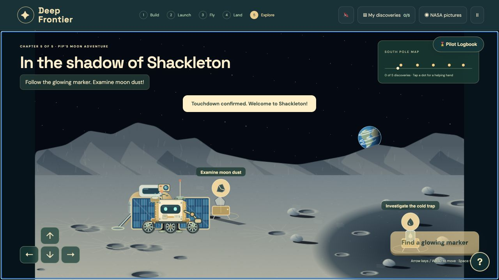
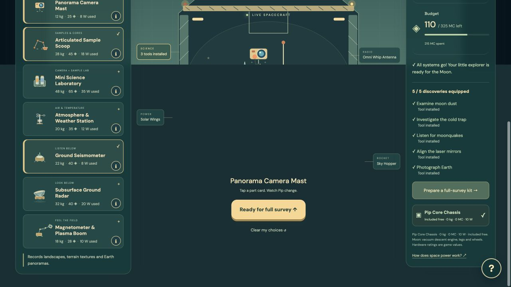

<div align="center">

# 🌌 DEEP FRONTIER

### Design. Launch. Explore. Discover.

**A playful, interactive space mission adventure that turns real science into hands-on exploration.**

Built for the **NASA Space Apps Challenge 2026** 🚀

[](https://deepfrontier.vercel.app/)
[](https://canva.link/z2llt3anrt4dbyc)
[](https://github.com/Riyan154/Nasa_Space_App)

**Three destinations** · **Five adventure chapters** · **Build-your-own spacecraft** · **Science challenges**


*Your mission begins here. Where will you explore first?*

</div>

---

## ✨ What is Deep Frontier?

**Deep Frontier** is a browser-based, science-inspired space adventure where players become mission designers and explorers. Rather than simply reading about space, they **build a spacecraft, make engineering decisions, launch from Earth, travel to another world, and carry out discoveries**.

Travel to **Titan**, **the Moon**, or **Mars**. Every destination offers a different landscape, landing sequence, and interactive science activity. The game is designed to be approachable for younger players while introducing genuine ideas from space science and mission engineering.

> **Our idea:** Make the excitement of space exploration accessible through discovery, creative choices, and play—not walls of technical information.

## 🔗 Quick links

| | Link |
| --- | --- |
| 🎮 **Play online** | **[deepfrontier.vercel.app](https://deepfrontier.vercel.app/)** |
| 📽️ **Project presentation** | **[View the Canva slides](https://canva.link/z2llt3anrt4dbyc)** |
| 💻 **GitHub repository** | [Riyan154/Nasa_Space_App](https://github.com/Riyan154/Nasa_Space_App) |
| 📚 **NASA sources and science notes** | [docs/SOURCES.md](docs/SOURCES.md) |

## 🪐 Choose your world

<table>
<tr>
<td width="33%" align="center"><br><b>🟠 Titan</b><br>Explore methane seas and investigate hydrocarbon chemistry.</td>
<td width="33%" align="center"><br><b>🌕 Moon</b><br>Visit the lunar south pole and search for clues in crater terrain.</td>
<td width="33%" align="center"><br><b>🔴 Mars</b><br>Explore Jezero Crater and study a world shaped by ancient water.</td>
</tr>
</table>

| Destination | Mission location | Signature activity |
| --- | --- | --- |
| **Titan** | Ligeia Mare or Kraken Mare | Compare methane and ethane absorption patterns |
| **Moon** | Shackleton Crater | Align a laser-reflection experiment |
| **Mars** | Jezero Crater | Control a scientific drill's pressure |

## 🎮 How to play

No download or account is needed to play the hosted game.

1. **Start your adventure.** Open [Deep Frontier](https://deepfrontier.vercel.app/) and choose **Titan, Moon, or Mars**.
2. **Build your explorer.** Spend your **325 mission coins** on a rocket, power system, science instruments, and communication equipment. Balance the available resources.
3. **Launch from Earth.** Hold the launch button (or **Space**) to take off. A vehicle that exceeds the rocket's lift limit may fail—return to the workshop and improve your design.
4. **Travel through space.** Steer using the **arrow keys or WASD** to avoid debris. Protect your hull as your spacecraft approaches its destination.
5. **Land and explore.** Complete the world's landing sequence, move around the environment, and approach glowing science markers.
6. **Perform experiments.** Use the appropriate instruments to complete interactive science challenges. If a tool is missing, return to the workshop and repack.
7. **Send science home.** Save discoveries, collect all **five** on a world, and transmit them to Earth to unlock your mission debrief and reward.
8. **Keep exploring.** Check your **Pilot Logbook** and try the other destinations.

> 💡 **Beginner tip:** Use **Prepare a full-survey kit** in the workshop for an example loadout, or choose your own components to discover how mission-design trade-offs work.

## 🖼️ Inside the game

### 01 · Build a mission that works

Choose from different rockets, energy systems, scientific instruments, and antennas. Each selection affects the mission's **mass, budget, and power requirements**. See your explorer take shape as you equip it.

<table>
<tr><td width="50%"></td><td width="50%"></td></tr>
<tr><td align="center"><sub>Choose a rocket and check lift capacity</sub></td><td align="center"><sub>Power your explorer for its journey</sub></td></tr>
<tr><td></td><td></td></tr>
<tr><td align="center"><sub>Pack tools for scientific discoveries</sub></td><td align="center"><sub>Choose how findings reach Earth</sub></td></tr>
</table>

### 02 · Launch and travel

<table>
<tr><td width="50%"></td><td width="50%"></td></tr>
<tr><td align="center"><sub>Launch from Earth</sub></td><td align="center"><sub>Navigate the journey and avoid hazards</sub></td></tr>
</table>

### 03 · Land and make discoveries

<table>
<tr><td width="50%"></td><td width="50%"></td></tr>
<tr><td align="center"><sub>Complete destination-specific landing sequences</sub></td><td align="center"><sub>Explore the surface and discover science</sub></td></tr>
</table>

### 04 · Learn, experiment, and track progress

<table>
<tr><td width="50%"></td><td width="50%"></td></tr>
<tr><td align="center"><sub>Explore illustrated explanations of equipment</sub></td><td align="center"><sub>Record achievements in the Pilot Logbook</sub></td></tr>
</table>

## ⭐ Features at a glance

- **Three explorable worlds** — Titan, the Moon, and Mars, each with distinctive visuals and mission activities.
- **Custom spacecraft builder** — choose rockets, power sources, scientific payloads, and communication equipment.
- **Engineering trade-offs** — learn why mass, money, and electricity matter before launch.
- **Interactive flight** — animated launch, steerable space transit, debris avoidance, and world-specific landings.
- **Hands-on science** — interactive experiments instead of passive fact sheets.
- **Five discoveries per destination** — collect evidence and transmit mission results.
- **Help for younger explorers** — illustrated equipment information and a four-page **Explorer Storybook**.
- **Progress and rewards** — expedition logbook, completion debrief, mission patch, and multi-world recognition.
- **Advanced workshop** — an optional deeper activity to configure spacecraft and inspect bundled NASA spacecraft models.
- **Accessible play options** — on-screen controls, keyboard navigation, sound controls, and reduced-motion support.

## 🕹️ Controls

| Action | Control |
| --- | --- |
| Launch / interact | **Space** or the on-screen action button |
| Steer / move | **Arrow keys**, **WASD**, or touch controls |
| Travel toward a location | Tap a surface-map marker or terrain |
| Help and instructions | **?** help button |
| Pause / settings | **Escape** or pause button |
| Sound | Speaker button |

## 🧠 The science behind the adventure

Deep Frontier takes inspiration from real-world planetary science and the engineering challenges of exploring space:

- **Titan:** Saturn's largest moon, with a dense nitrogen atmosphere and lakes of liquid hydrocarbons.
- **The Moon:** A near-airless world whose polar regions are important for understanding water ice and future exploration.
- **Mars:** A planet with evidence of ancient water, including the sedimentary history of Jezero Crater.
- **Spacecraft engineering:** Payload mass, electrical power, scientific instruments, communication systems, and destination conditions all influence mission design.

The game carefully separates **scientific reference material** from **fictional mission mechanics**. Mission coins, flight durations, some equipment values, challenge data, and simplified orbital diagrams are educational/gameplay representations—not real NASA mission specifications or predictions.

### NASA resources and acknowledgements

The project uses or references NASA science information and resources including:

- [NASA Science](https://science.nasa.gov/) for planetary background.
- [NASA Image and Video Library](https://images.nasa.gov/) for credited scientific imagery in the optional gallery.
- [NASA Planetary Data System](https://pds.nasa.gov/) for planetary archive references and optional data discovery.
- **Cassini–Huygens mission material** and locally bundled model assets, with credits documented in the repository.

For technical details and precise attribution, see **[Science and NASA Integration](docs/SOURCES.md)**, [model credits](src/models/CREDITS.md), and [reward image credits](src/rewards/CREDITS.md). The core illustrated gameplay uses original 2D Canvas/SVG artwork; the screenshots above show the actual game.

## 🛠️ Technology

| Area | Used for |
| --- | --- |
| **HTML5 & CSS3** | Website structure, styling, and responsive interfaces |
| **Vanilla JavaScript (ES modules)** | Game logic, interaction, mission state, and navigation |
| **HTML Canvas & SVG** | Original 2D illustrations and animated gameplay |
| **Web Audio API** | Synthesized game sounds and feedback |
| **Browser localStorage** | Local preferences, expedition history, and saved progress |
| **Node.js 20+** | Local development server, build, and test commands |
| **Vercel** | Hosting the playable web experience |
| **NASA public resources** | Science context, credited imagery, datasets, and model references |

The main browser adventure does **not** require runtime npm packages, a login, or a personal NASA API key.

## 💻 Run locally

**Requirements:** Node.js **20 or newer**.

```bash
git clone https://github.com/Riyan154/Nasa_Space_App.git
cd Nasa_Space_App
npm start
```

Open **http://127.0.0.1:4173/** in your browser.

> Run the game through the local HTTP server rather than opening `index.html` directly, because JavaScript modules require an appropriate serving environment.

### Development commands

```bash
npm test        # Run the Node.js test suite
npm run build   # Build static files into dist/
```

The optional NASA gallery/archive features may need internet access. The adventure itself uses locally bundled gameplay assets. Saves are stored in the current browser, so clearing its data may erase progress.

## 🎯 Why we built it

Space missions combine imagination with problem-solving. A rocket must carry its payload, an explorer needs enough electrical power, scientific equipment must match its goals, and gathered data must reach home.

Our aim is to help younger players **think like explorers and engineers** by experiencing those decisions in an inviting, visual game. Deep Frontier combines creativity, science education, and interactive challenges to show that exploration is as much about **asking questions and solving problems** as it is about reaching distant worlds.

## 📖 More project documentation

| Document | What it covers |
| --- | --- |
| [NASA sources](docs/SOURCES.md) | Research sources, APIs, attribution, and limitations |
| [Science interactions](docs/SCIENCE_INTERACTIONS.md) | Experiments and simplified orbital mechanics |
| [Pilot and telemetry guide](TELEMETRY_AND_PILOT_GUIDE.md) | Game systems and flight guidance |
| [Mission notes](docs/MOON_MISSION.md) | Destination and exploration design |
| [Spacecraft model credits](src/models/CREDITS.md) | NASA model assets and acknowledgment |

---

<div align="center">

### 🌠 Ready for your next discovery?

**One launch can begin an extraordinary adventure.**

[**🎮 Play Deep Frontier**](https://deepfrontier.vercel.app/) · [**📽️ View Our Presentation**](https://canva.link/z2llt3anrt4dbyc)

*Created for NASA Space Apps Challenge 2026 · An independent educational project, not an official NASA game.*

</div>
