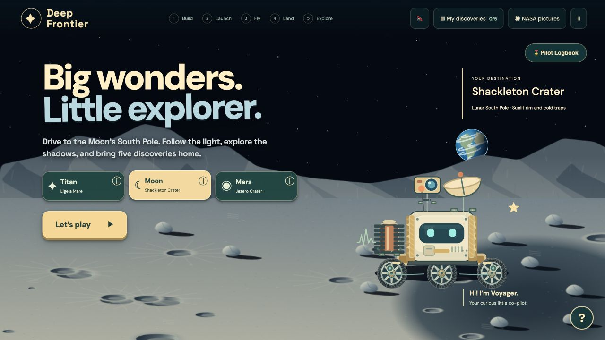
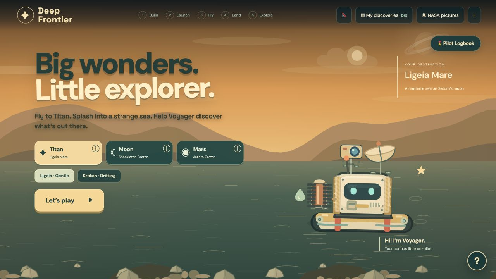
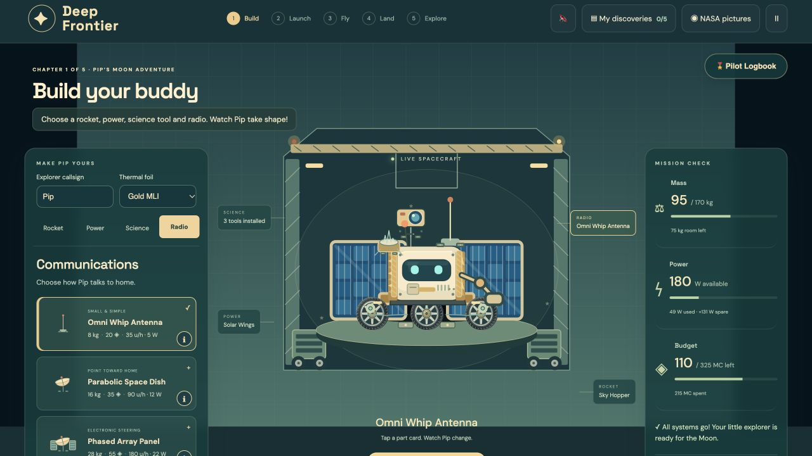
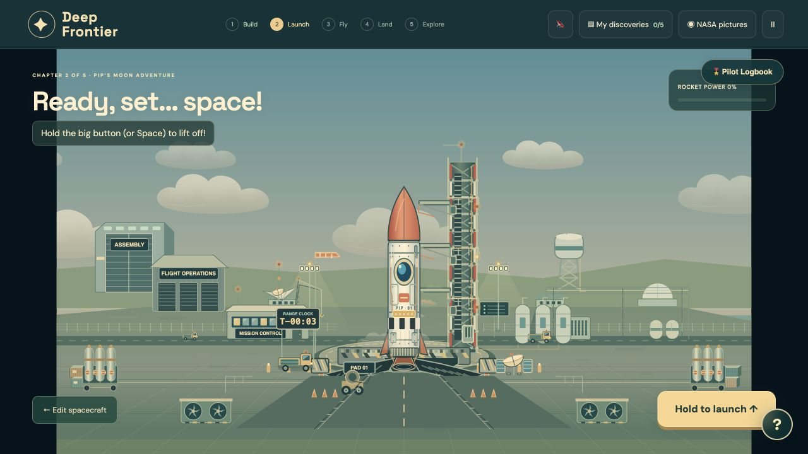
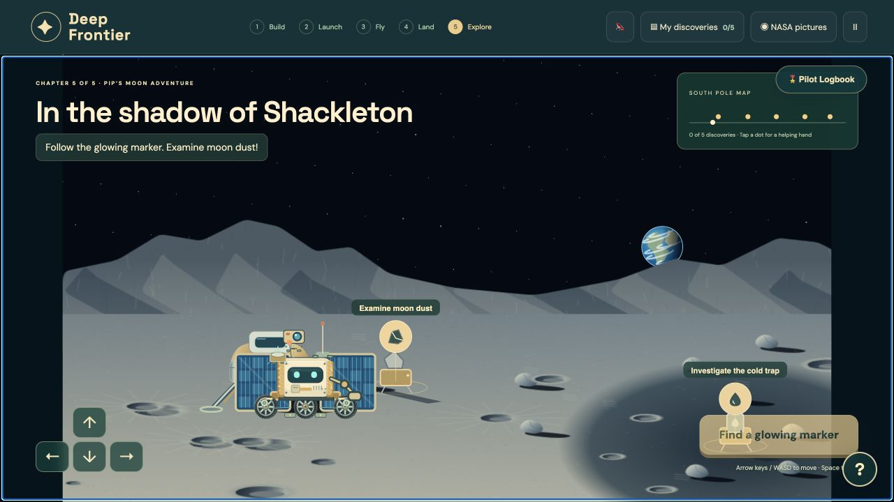
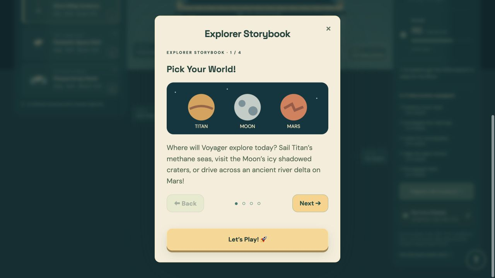
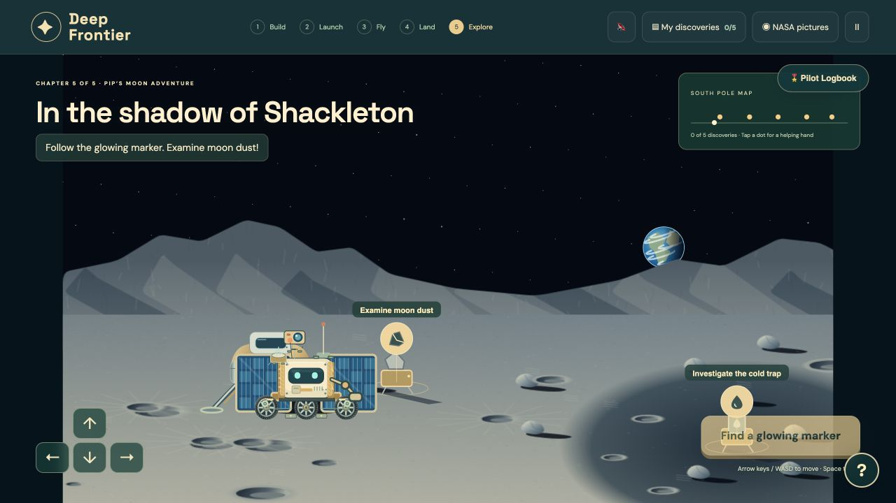
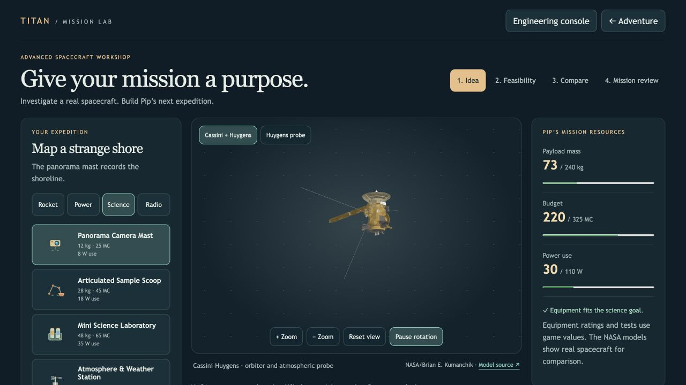

# Deep Frontier

**Build an explorer. Launch from Earth. Discover three extraordinary worlds.**

Deep Frontier is an animated space adventure built with original 2D Canvas and SVG artwork. Travel with Voyager to Titan’s methane seas, the Moon’s south pole, or the ancient delta of Mars. Choose equipment, dodge space debris, land, investigate five discoveries, and send your science home.

**Three destinations · Five chapters · 325 mission coins · Zero runtime dependencies**



## Start playing

You need **Node.js 20 or newer**. No `npm install`, Unity editor, account, or API key is required for local gameplay.

From the game folder:

```sh
npm start
```

Open [http://127.0.0.1:4173/](http://127.0.0.1:4173/) and keep the terminal running. Press **Control+C** to stop the server.

On this Mac, you can also double-click **Open TITAN.command**. The launcher keeps its historical filename; the game is now called **Deep Frontier**.

Do not double-click `index.html`: ES modules need an HTTP server.

## Pick your destination

| Destination | Explore | Landing and science |
| --- | --- | --- |
| **Titan** | Ligeia Mare or the stronger currents of Kraken Mare | Atmospheric entry, parachute and flotation hull; methane/ethane identification. |
| **Moon** | Shackleton Crater at the lunar south pole | Powered descent and a wheeled rover; laser alignment, regolith, cold traps and moonquakes. |
| **Mars** | Jezero Crater | Atmospheric entry, parachute and powered sky-crane descent; sedimentary sampling and a drill challenge. |

<table>
<tr><th>Titan · Amber skies and hydrocarbon seas</th><th>Mars · Jezero Crater</th></tr>
<tr>
<td></td>
<td></td>
</tr>
</table>

## Build your explorer

Start with an empty equipment selection and **325 mission coins**. The included core costs no coins and adds no payload mass, but consumes **10 W**.

Choose a rocket, power source, science tools, and radio. Every installed tool adds mass, cost and power demand. Watch the five-objective checklist or select **Prepare a full-survey kit** to equip an example mission.

- **Rocket:** Sky Hopper, Starlight Lifter or Cosmic Titan, with different lift limits and prices.
- **Power:** Solar Wings, an RTG, battery storage or a hybrid RTG/battery kit.
- **Science:** Camera, sample scoop, laboratory, weather station, seismometer, ground radar and magnetometer.
- **Radio:** Whip antenna, parabolic dish or phased array.

Small **ℹ** buttons explain Power, Science and Radio equipment with an illustration and useful-world tags. Rocket cards intentionally have no info button. Choose Gold MLI, Deep Amber or NASA Royal Blue thermal trim.

<table>
<tr><th>Rocket selection</th><th>Power systems</th></tr>
<tr>
<td></td>
<td></td>
</tr>
<tr><th>Science payload</th><th>Communications</th></tr>
<tr>
<td></td>
<td></td>
</tr>
</table>

## Launch, fly and land

Hold the launch button or Space to lift off from the detailed Earth launch site. Overweight ships can attempt a launch, then fail in the practice simulator; the recovery button returns the exact kit to the workshop.

The flight chapter combines a top-down orbital transfer diagram with a debris-dodging minigame. **Moon transit lasts 10 active seconds, Mars 15, and Titan 30.** Use arrows or WASD to steer. Four separate hits exhaust the hull; retry restores it. **Skip to Landing** advances immediately, without adding damage, but does not award the clean-flight evasive bonus.

The capsule uses one rear engine. Its exhaust tilts opposite vertical steering, grows with forward input, and becomes a slower idle plume when reversing. There are no front or side thruster jets.

<table>
<tr><th>Earth launch site</th><th>Orbital transfer and debris dodging</th></tr>
<tr>
<td></td>
<td></td>
</tr>
<tr><th>Powered lunar arrival</th><th>Surface exploration</th></tr>
<tr>
<td></td>
<td></td>
</tr>
</table>

## Make discoveries

Follow glowing markers and use the appropriate installed instrument. Missing-tool prompts explain what to bring. **Repack and relaunch** preserves earned discoveries.

Each destination includes a hands-on science challenge:

| World | Challenge |
| --- | --- |
| Moon | Align a practice laser mirror for three seconds, then observe an illustrative Earth–Moon round-trip signal delay. |
| Titan | Match schematic methane and ethane absorption fingerprints. |
| Mars | Tap to keep drill pressure in the safe zone and avoid overheating. |

Finish the experiment and choose **Save my discovery** to earn it. Collect all five discoveries, then downlink them to Earth to unlock the expedition debrief, mission patch, and a credited NASA mission photo.

Titan currents drift the unanchored boat left and downward; Kraken is stronger than Ligeia. The current adventure has **no deploy-stabilizers button**. Movement also releases stabilizers in older anchored saves. Water wakes, tire tracks and driving dust trails have been removed from all three worlds; landing effects remain.

## Help, equipment guides and rewards

The circular **?** button opens a four-card illustrated **Explorer Storybook**. Navigate with Back/Next or close it immediately with **Let’s Play!**

The **Pilot Logbook** tracks expeditions, returned discoveries, science scores, mission time, energy and stars. Completing the three destinations unlocks the Grand Tour recognition.

<table>
<tr><th>Illustrated equipment guide</th><th>Explorer Storybook</th></tr>
<tr>
<td></td>
<td></td>
</tr>
<tr><th colspan="2">Pilot Logbook · expedition progress across all three destinations</th></tr>
<tr><td colspan="2"></td></tr>
</table>

## Advanced spacecraft workshop

Open **Pause and settings → Advanced spacecraft workshop** for a separate engineering activity:

1. Choose a science question.
2. Inspect the locally bundled NASA Cassini–Huygens and Huygens models.
3. Configure equipment and run power/downlink feasibility tests.
4. Save and compare designs.
5. Review the mission and launch the prepared expedition.

The NASA inspection viewer uses original native Canvas code and exported mesh geometry. No third-party 3D renderer or runtime decoder is needed. **Engineering console** opens the older, more detailed Titan mission simulator, with its own design and flight rules.



## Controls, sound and saves

| Action | Control |
| --- | --- |
| Launch | Hold the large launch button or Space. |
| Steer or drive | Arrow keys, WASD, or the on-screen directional buttons. |
| Travel to a science marker | Tap a surface map dot; you can also tap the terrain. |
| Current action | Large action button or Space. |
| Help | Circular **?** button. |
| Audio | Speaker button in the navigation bar. |
| Pause/settings | Pause button or Escape during an expedition. |

Sound is synthesized with Web Audio: launch rumble, thruster hiss, impacts, discovery chimes and downlink chirps. Sounds in vacuum are cockpit feedback, not sound traveling through space.

Reduced-motion support suppresses shake and moving particle effects. Dialogs support keyboard navigation. Preferences, missions and the logbook are stored in browser local storage; changing the origin or clearing browser data changes/removes that save. Older supported saves are migrated.

## Science and artwork

Environment facts, NASA photographs and spacecraft references are distinguished from fictional game values. Prices, hardware performance, timing, resource accounting, encounters and science scores are teaching/gameplay systems.

The transfer diagram is a simplified circular-orbit teaching model, not a mission-planning solver. The Moon uses powered landing in vacuum; Titan and Mars use destination-specific atmospheric landing sequences. The polar laser station is fictional, and the spectrometer curves are schematic rather than calibrated measurements.

Gameplay artwork is original Canvas/SVG illustration. All **15 screenshots in this README** were captured from the current game on 15 November 2026. NASA photo and model credits remain bundled with their assets.

Read more:

- [NASA sources and integration notes](docs/SOURCES.md)
- [Science challenges and orbital-transfer assumptions](docs/SCIENCE_INTERACTIONS.md)
- [Moon and multi-world mission notes](docs/MOON_MISSION.md)
- [Equipment balancing](docs/REBALANCE.md)
- [NASA model credits](src/models/CREDITS.md)
- [NASA reward/photo credits](src/rewards/CREDITS.md)

The NASA gallery requires internet access. Gameplay, local fonts, original artwork, bundled reward images and the model viewer use local assets. Image Library/PDS access uses no frontend API key. The local server provides a fixed read-only PDS relay; static hosts may use the labeled archive fallback when browser access is blocked.

## Develop and test

Vanilla JavaScript ES modules, HTML5 Canvas, SVG and Web Audio. **Zero runtime npm dependencies.**

```sh
npm test
npm run build
```

The Node built-in suite currently has **103 passing tests**, covering mission state, budgets, science access, save migration, flight timing, recovery, audio cleanup, workshop behavior and NASA response validation. Tests use mocked network responses.

`npm run build` copies the browser application to `dist/`. Serve that directory with any static host. Documentation screenshots stay under `docs/images/` and are not shipped as gameplay assets. No secrets belong in `src/` or `dist/`.

| Area | Files |
| --- | --- |
| Adventure controller and saves | `src/adventure.js`, `src/adventure-model.js`, `src/storage.js` |
| Equipment and component guides | `src/builder-model.js`, `src/builder-view.js`, `src/component-info.js` |
| Vector artwork | `src/adventure-art.js`, `src/station-art.js`, `src/planet-art.js`, `src/wheel-art.js` |
| Flight and failure recovery | `src/transit.js`, `src/titan-flight.js`, `src/failure.js` |
| Science and rewards | `src/science-model.js`, `src/science-view.js`, `src/mission-reward.js` |
| Storybook, logbook and audio | `src/academy.js`, `src/pilot-logbook.js`, `src/mission-audio.js` |
| Advanced engineering | `src/mission-lab.js`, `src/lab-model.js`, `src/engine.js` |
| Local serving and static build | `server.js`, `build.js` |

## Troubleshooting

- **Website will not load:** run `npm start` again and keep the terminal open. A stopped local server cannot serve the game.
- **Port 4173 is busy:** use `PORT=4174 npm start` and open that port instead.
- **Blank page after opening an HTML file:** use the local HTTP URL rather than `file://`.
- **NASA gallery cannot connect:** play locally and retry the gallery later; remote outages do not prevent the expedition.
- **A discovery is blocked:** check its required instrument, then repack the craft.
- **An upgrade is too expensive:** remove or replace equipment; the adventure budget is 325 MC.

There is no multiplayer, account/cloud-save system, live mission-control connection or guaranteed offline installation. Device-independent 60fps is not a measured guarantee.
